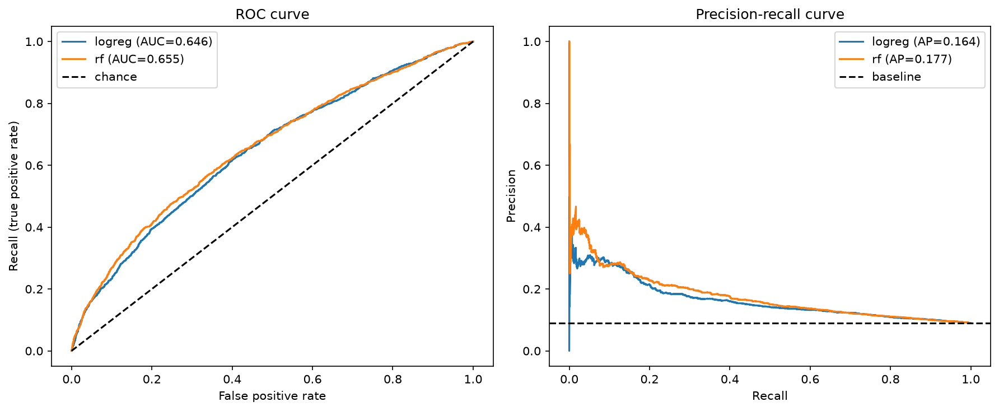
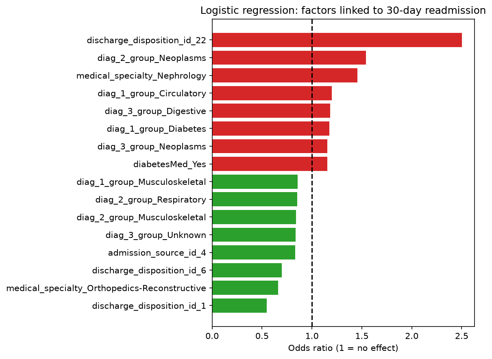

# Healthcare Readmission Risk Prediction

Predicting 30-day hospital readmission for diabetic patients using
Python, Pandas and Scikit-learn, with a stakeholder-style report.

## Problem
Hospital readmissions harm patients and cost money. This project builds a
model that flags patients at high risk of readmission within 30 days of
discharge, so follow-up can be targeted.

## Data
UCI "Diabetes 130-US Hospitals (1999-2008)": 101,766 encounters, 50
variables. After cleaning (one encounter per patient, deaths and hospice
removed): **69,987 patients**. Raw data is not stored in this repo, so see
`data/README.md` for the download link.

## Approach
1. **Cleaning:** missing values, removed patients who could not be readmitted, one row per patient to prevent leakage
2. **Feature engineering:** 28 model features, including grouped ICD-9 diagnoses, prior-visit counts, medication counts and lab-test flags
3. **Modeling:** Logistic Regression vs Random Forest, 5-fold stratified cross-validation, pipelines so scaling and encoding learn only from training data
4. **Evaluation:** ROC-AUC, PR-AUC and recall (not accuracy, because only about 9% of patients are readmitted)
5. **Threshold:** chosen on training cross-validation to reach 60% recall, then tested once on held-out data

## Results (held-out test set, n = 13,998)
| Model | ROC-AUC | PR-AUC | Recall @0.5 | Precision @0.5 |
|---|---|---|---|---|
| Logistic Regression | 0.646 | 0.164 | 0.543 | 0.137 |
| Random Forest | 0.655 | 0.177 | 0.364 | 0.183 |

Random Forest had the higher ROC-AUC, so it is used for the final risk
threshold. Logistic regression odds ratios are used to explain the main
risk drivers.

At the chosen threshold (0.417), the random forest flags 39.1% of patients
and catches 59.6% of readmissions, with 13.7% precision (about 1.5 times
the 9.0% baseline rate).




## Key findings
- **Discharge destination is the strongest driver:** 26.4% of patients
  transferred to rehab were readmitted within 30 days, versus 6.9% of
  those discharged home.
- **Prior hospital use matters:** the readmission rate rises from 8.1%
  with no prior inpatient stays to 26.5% with three or more.
- **Primary diagnosis has a smaller effect:** rates ranged from 7.3%
  (respiratory) to 10.8% (injury), around the 9.0% average.
- **Clinical complexity matters:** the readmission rate rises from 7.0%
  for patients with 5 or fewer diagnoses to 10.0% for those with 8 to 9.
## How to reproduce
```bash
pip install -r requirements.txt
```
1. Download the data into `data/` (see `data/README.md`)
2. Run `notebooks/01_eda.ipynb`, then `02_feature_engineering.ipynb`, then `03_modeling.ipynb`

## Limitations and next steps
- 1999-2008 diabetic patients only; needs validation on recent data
- Associations, not causal effects
- Modest discrimination (ROC-AUC 0.655), typical for readmission models
- Next: try gradient boosting, calibrate probabilities, check performance across age and race groups

## Citation
Strack et al., "Impact of HbA1c Measurement on Hospital Readmission Rates",
BioMed Research International, 2014.