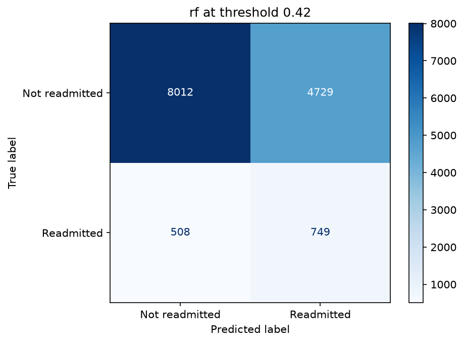

# Reducing 30-Day Readmissions: Risk Model Findings

## 1. The problem
About 9.0% of the diabetic patients in this dataset were readmitted within
30 days of discharge. Readmissions are harmful to patients and costly for
hospitals, and in the US they can trigger financial penalties under the
Hospital Readmissions Reduction Program. If we can identify high-risk
patients before they leave, staff can focus follow-up on them.

## 2. What we did
We analysed 69,987 hospital stays from 130 US hospitals (1999-2008), keeping
one stay per patient and removing patients who died or went to hospice.
We built a model that gives each patient a readmission risk score at
discharge, using only information available at that time.

## 3. What drives readmission
1. **Discharge destination:** 26.4% of patients transferred to a rehab
   facility were readmitted within 30 days, versus 6.9% of those
   discharged home. That is almost 4 times higher. Patients sent to a
   skilled nursing facility (13.4%) and short-term hospitals (13.8%) also
   had elevated rates.
2. **Prior inpatient stays:** the readmission rate rises from 8.1% with no
   prior inpatient stays to 12.9% with one, 18.5% with two, and 26.5%
   with three or more.
3. **Number of diagnoses:** the readmission rate rises from 7.0% for
   patients with 5 or fewer diagnoses to 8.6% for 6 to 7 diagnoses and
   10.0% for 8 to 9 diagnoses.
4. **Primary diagnosis:** differences were modest. Injury (10.8%) and
   circulatory conditions (9.7%) were above the 9.0% average, while
   respiratory conditions were lowest (7.3%). Groups with very few
   patients were excluded from this comparison.

## 4. How well the model works
- At the chosen threshold, the model flags **39.1%** of patients as high risk.
- It catches **59.6%** of the patients who were actually readmitted.
- About **13.7%** of flagged patients are actually readmitted, versus a
  baseline of 9.0%. That is about 1.5 times better than picking patients
  at random.
- Overall ranking ability (ROC-AUC) is 0.655. This is typical for
  readmission models: useful for prioritising, not for predicting
  individual patients with certainty.

## 5. Recommendations
1. Follow-up call within 48 hours for flagged patients.
2. Extra discharge planning for patients with three or more prior inpatient stays and for those transferred to rehab facilities, who had the highest readmission rates.
3. Medication review for patients with several diagnoses.
4. Pilot the model on one ward and measure whether readmissions fall
   before rolling it out.

## 6. Limitations
- Data is from 1999-2008 and covers diabetic patients only.
- The model finds associations, not causes.
- No social, income or post-discharge data was available.
- Most flagged patients (about 86%) will not be readmitted, so follow-up
  should be low-cost, such as a phone call.
- It needs validation on recent local data before any real use.